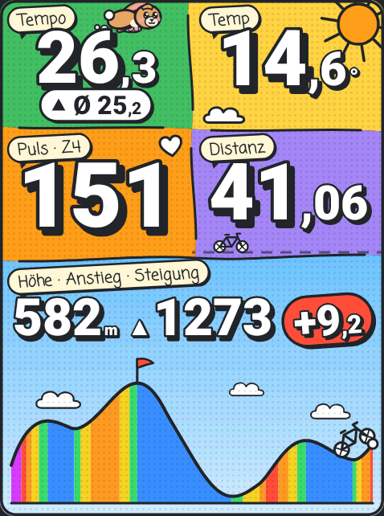
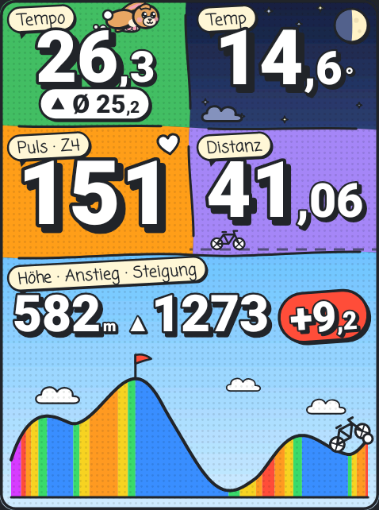
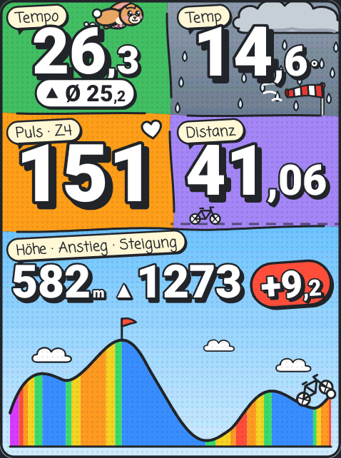
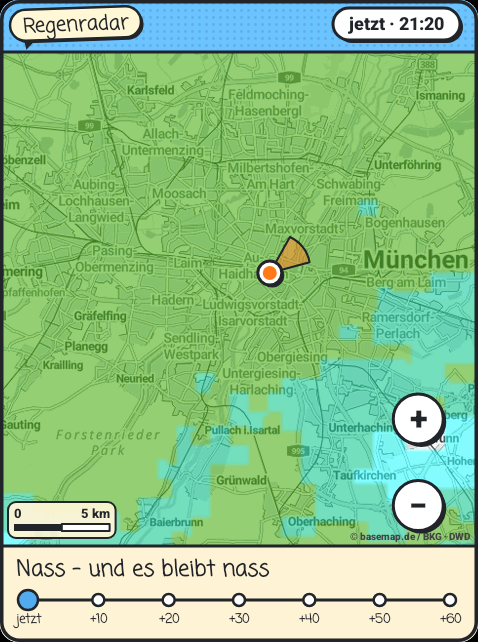

# Karoo Fun

**Dein Hammerhead Karoo 3 wird zum Comic.** Tempo, Temperatur, Puls, Distanz und das gefahrene Höhenprofil auf einer knallbunten Seite, mit echtem Himmel, Live-Wetter und Comic-Aktionen. Dazu ein Regenradar als eigene Kachel.

<p>
  
  
  
  
</p>

## Download

👉 **[Neueste Version herunterladen](https://github.com/HannoP1983/karooFun/releases/latest)**: die Datei `karoo-fun-….apk` unter „Assets“.

Wie die App per USB-Kabel auf den Karoo kommt, steht Schritt für Schritt auf der [Promo-Seite](promo/index.html) unter „Keine Ahnung von Technik? Kein Problem!“ (auch als [PDF](promo/Karoo-Fun.pdf)).

## Was drin ist

- **Comic-Cockpit** (eine ganze Fahrtseite): Tempo mit Schnitt, Hase oder Schnecke · Temperatur mit Sonnenstand, Mondphase, Wetter und Windsack · Puls nach Zonen · Distanz · live wachsendes Höhenprofil nach Steigung eingefärbt
- **Comic-Aktionen**, die kurz den ganzen Bildschirm übernehmen: „Pokal oder Spital?!“ bei schnellen Abfahrten, „You're on fire!“ bei Vollgas, „Party-Pace wins the race!“ beim konstanten Fahren
- **Einzelfelder** im Comic-Stil zum Selberbauen eigener Seiten, gemacht für 2 × 4: Geschwindigkeit (aktuell, Ø, Max), Distanz, Höhenprofil, Herzfrequenz (aktuell, Ø, Zone, Max, % Max), Trittfrequenz (aktuell, Ø, Max) und Temperatur mit Wetter. Im Karoo beim Seitenbau unter „Karoo Fun“, nach Kategorie sortiert
- **Regenradar** (eigene Kachel): DWD-Radar auf einer grauen Deutschlandkarte, Zoom mit + und −, Prognose für die nächste Stunde in 10-Minuten-Schritten, Ansage für deinen Standort
- **Einstellungen** am Karoo unter Einstellungen › Apps › Karoo Fun › Öffnen

Wetter und Radar brauchen eine Verbindung (Hammerhead Companion-App auf dem Handy oder WLAN am Karoo). Radar und Karte gibt es für Deutschland und die Grenzgebiete.

## Selbst bauen

Voraussetzung: JDK 17 oder neuer und das Android SDK (z. B. über Android Studio).

```sh
./gradlew testDebugUnitTest   # Tests
./gradlew assembleDebug       # Test-APK: app/build/outputs/apk/debug/app-debug.apk
```

Die Debug-Variante enthält zusätzlich `PreviewActivity` zum Ansehen der Seiten auf einem Emulator ohne Karoo.

## Neue Version veröffentlichen

1. In `app/build.gradle.kts` `versionCode` um 1 erhöhen und `versionName` setzen, z. B. `1.2`.
2. Committen und einen Tag mit derselben Version setzen, z. B. `v1.2`, beides pushen.
3. GitHub Actions testet, baut die signierte APK und legt das Release `Karoo Fun 1.2` mit `karoo-fun-1.2.apk` an.

Der Build braucht zwei Repository-Secrets (Settings › Secrets and variables › Actions):

| Secret | Inhalt |
|---|---|
| `KEYSTORE_BASE64` | der Release-Schlüssel als Base64 |
| `KEYSTORE_PASSWORD` | das Passwort des Schlüssels |

Der Schlüssel selbst liegt nie im Repo. Lokal zeigt `local.properties` mit `signing.properties=/pfad/zur/signing.properties` auf ihn.

## Datenquellen

- Regenradar: [Deutscher Wetterdienst](https://www.dwd.de) (GeoServer, Datenbasis DWD)
- Karte: © [basemap.de](https://basemap.de) / BKG
- Wetter: [Open-Meteo.com](https://open-meteo.com) (CC BY 4.0)
- Karoo-Schnittstelle: [karoo-ext](https://github.com/hammerheadnav/karoo-ext) von Hammerhead

## Lizenz

Siehe [LICENSE](LICENSE).
