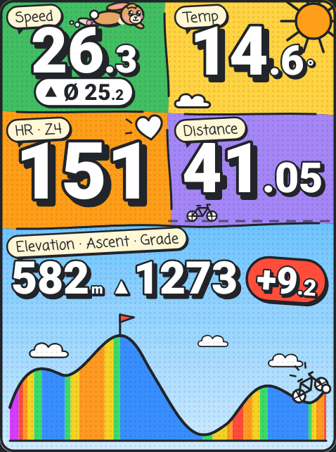
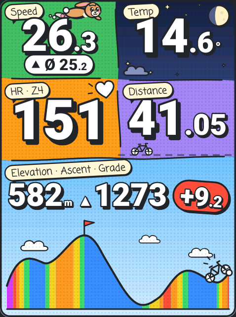
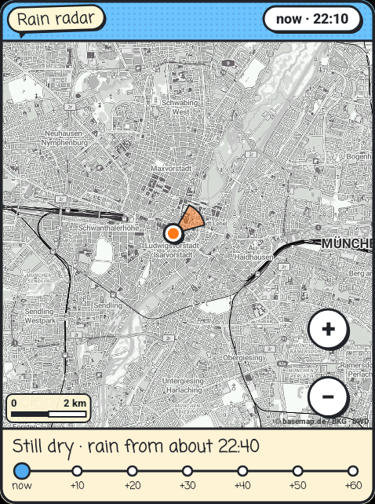
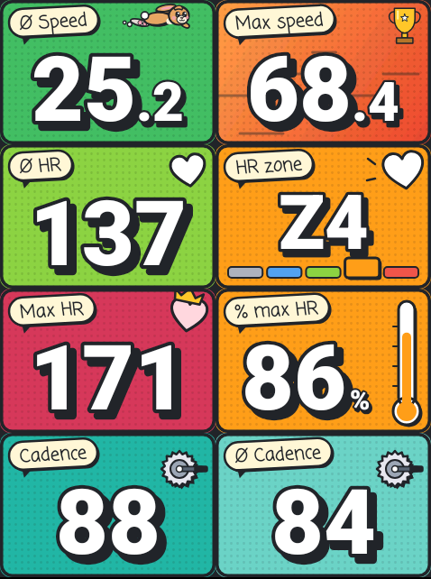
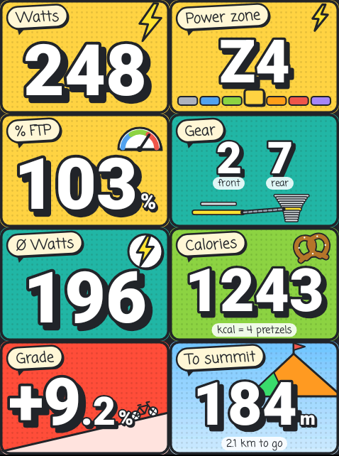
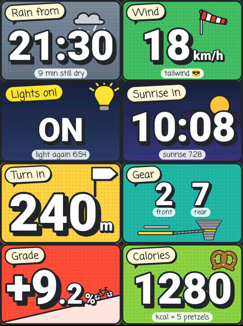

# Karoo Fun

**English** | [Deutsch](README.de.md)

**Your Hammerhead Karoo 3 turns into a comic.** Speed, temperature, heart rate, distance and the elevation profile you ride on one bright page, with the real sky, live weather and comic actions. Plus a rain radar tile and every value as a single field for your own pages.

<p>
  
  
  
  
  
</p>

## Download

👉 **[Download the latest version](https://github.com/HannoP1983/karooFun/releases/latest)**: the file `karoo-fun-….apk` under "Assets".

How to get the app onto the Karoo with a USB cable is explained step by step on the [promo page](promo/en/index.html) (also as [PDF](promo/Karoo-Fun-en.pdf)). In German: [promo page](promo/index.html) and [PDF](promo/Karoo-Fun.pdf).

## What's inside

- **Comic Cockpit** (a whole ride page): speed with average, bunny or snail · temperature with the sun's position, moon phase, weather and windsock · heart rate by zone · distance · elevation profile growing live, colored by grade
- **Comic actions** that take over the whole screen for a moment: "Pokal oder Spital?!" (trophy or hospital) on fast descents, "You're on fire!" at full gas, "Party-Pace wins the race!" when riding steadily
- **Single fields** in comic style for building your own pages, made for 2 × 4: speed (now, average, max), distance, elevation profile, heart rate (now, average, zone, max, % of max), cadence (now, average, max), temperature with weather and, since 1.4, power (watts, average, zone, % FTP), gear with the drivetrain seen from above, grade, to the summit, next turn, calories in pretzels, rain, wind, lights on and sunset. On the Karoo under "Karoo Fun" when editing a page, sorted by category
- **Rain radar** (its own tile): DWD radar on a grey map of Germany, zoom with + and −, forecast for the next hour in 5-minute steps, outlook for your position
- **Settings** on the Karoo under Settings › Apps › Karoo Fun › Open, including the language: German, English or automatic like the Karoo

Weather and radar need a connection (Hammerhead Companion app on the phone or WiFi on the Karoo). Radar and map cover Germany and its border regions.

### Single fields

<p>
  
  
  
</p>

Left: speed, heart rate and cadence. Middle and right, new in 1.4: power, gear with the drivetrain seen from above, grade, to the summit, calories in pretzels, rain from the radar, wind, lights on, sunrise and next turn.

## Putting it on the Karoo

On the Karoo, open **Pages** in your ride profile and add a page:

- **Comic Cockpit:** layout with a single field, then **Karoo Fun › Comic Cockpit**
- **Rain Radar:** the same with **Karoo Fun › Rain Radar**
- **Your own page:** e.g. a 2 × 4 layout, then pick each field on its own. They are listed under **Karoo Fun** and named by category:

| Category | Fields |
|---|---|
| Speed | Now · Avg · Max |
| Distance | Ride |
| Elevation | Profile (looks best in a wide field) · Grade · To summit |
| Heart rate | Now · Avg · Zone · Max · % max |
| Cadence | Now · Avg · Max |
| Power | Watts · Avg · Zone · % FTP (needs a power meter) |
| Shifting | Gear (needs electronic shifting, e.g. Di2 or AXS) |
| Energy | Calories |
| Navigation | Next turn (needs a route) |
| Weather | Temperature · Rain · Wind |
| Sky | Lights on in · Sunset in |

Set heart rate zones and max heart rate under Settings › Apps › Karoo Fun › Open; they apply to the cockpit and the single fields. That is also where you set how many chainrings and cogs the gear field draws (up to 2 × 14) if your shifting does not report it. FTP and power zones come from your Karoo profile. The language chosen there applies to everything the app draws. The names in the Karoo's field list always follow the Karoo's system language.

## Building it yourself

Requirements: JDK 17 or newer and the Android SDK (e.g. via Android Studio).

```sh
./gradlew testDebugUnitTest   # tests
./gradlew assembleDebug       # test APK: app/build/outputs/apk/debug/app-debug.apk
```

The debug build also contains `PreviewActivity` to look at the pages on an emulator without a Karoo; `--es page fields` shows the single fields on a 2 × 4 page, `--es lang en` renders in English.

## Releasing a new version

1. In `app/build.gradle.kts`, increase `versionCode` by 1 and set `versionName`, e.g. `1.2`.
2. Commit and add a tag with the same version, e.g. `v1.2`, and push both.
3. GitHub Actions runs the tests, builds the signed APK and creates the release `Karoo Fun 1.2` with `karoo-fun-1.2.apk`.

The build needs two repository secrets (Settings › Secrets and variables › Actions):

| Secret | Content |
|---|---|
| `KEYSTORE_BASE64` | the release key as Base64 |
| `KEYSTORE_PASSWORD` | the key's password |

The key itself is never in the repo. Locally, `local.properties` points to it with `signing.properties=/path/to/signing.properties`.

## Data sources

- Rain radar: [Deutscher Wetterdienst](https://www.dwd.de) (GeoServer, data basis DWD)
- Map: © [basemap.de](https://basemap.de) / BKG
- Weather: [Open-Meteo.com](https://open-meteo.com) (CC BY 4.0)
- Karoo interface: [karoo-ext](https://github.com/hammerheadnav/karoo-ext) by Hammerhead

## License

See [LICENSE](LICENSE).
